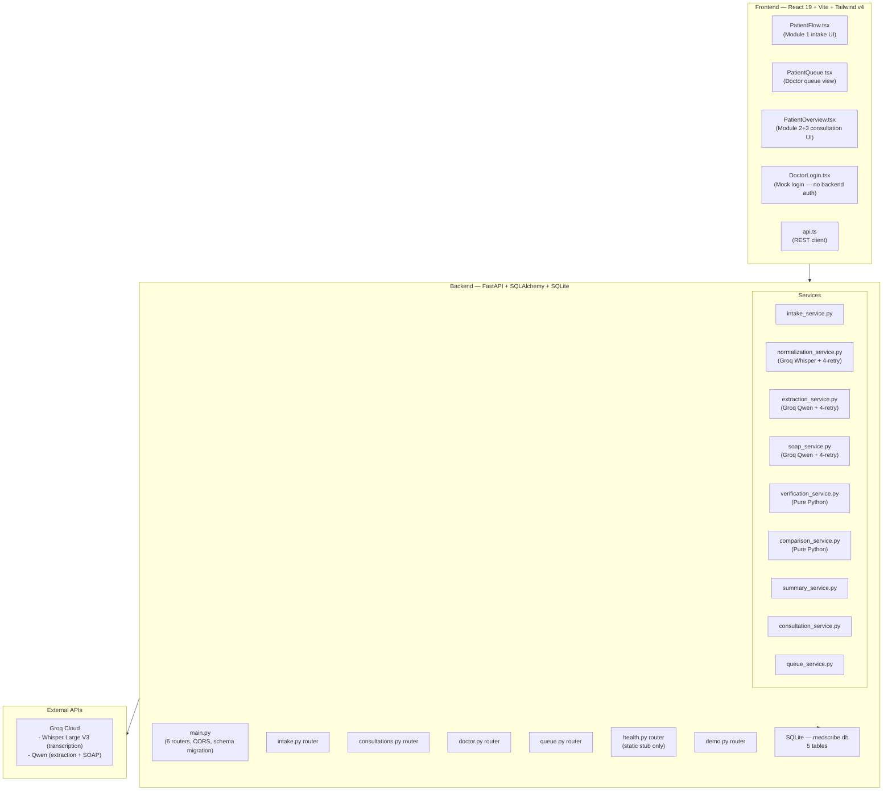
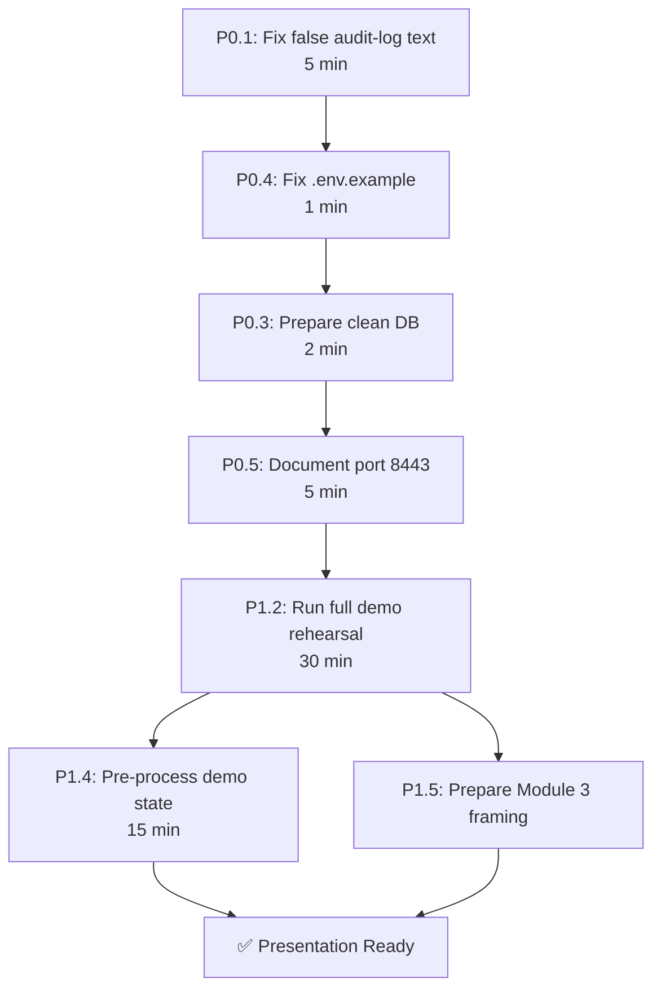

# Medscribe — Comprehensive Investigation Report
**Investigation Date:** 20 November 2026  
**Report Status:** Final  
**Scope:** Read-only investigation for presentation-readiness assessment  
**Methodology:** Evidence-based — all findings verified in code, executed tests, or confirmed via safe inspection commands. Sources cited by file and line number.

---

## Table of Contents
1. [Executive Summary](#1-executive-summary)
2. [Repository & Environment](#2-repository--environment)
3. [Architecture & Tech Stack](#3-architecture--tech-stack)
4. [Module 1 — Patient Intake](#4-module-1--patient-intake-status)
5. [Module 2 — Consultation Intelligence](#5-module-2--consultation-intelligence-status)
6. [Module 3 — Longitudinal Patient Record](#6-module-3--longitudinal-patient-record-status)
7. [Frontend Status](#7-frontend-status)
8. [Backend & Database Status](#8-backend--database-status)
9. [API Inventory](#9-api-inventory)
10. [Test Suite Results](#10-test-suite-results)
11. [Clinical Safety Invariants](#11-clinical-safety-invariants)
12. [Known Bugs & Risks](#12-known-bugs--risks)
13. [End-to-End Demo Readiness Assessment](#13-end-to-end-demo-readiness-assessment)
14. [P0 — Presentation Blockers](#14-p0--presentation-blockers)
15. [P1 — Essential Before Presentation](#15-p1--essential-before-presentation)
16. [P2 — Post-Presentation Improvements](#16-p2--post-presentation-improvements)
17. [P3 — Future / Production Roadmap](#17-p3--future--production-roadmap)
18. [Recommended Development Sequence](#18-recommended-development-sequence)
19. [Startup Commands](#19-startup-commands)
20. [Demo Scenario](#20-demo-scenario)

---

## 1. Executive Summary

Medscribe is **approximately 70% presentation-ready** as of this investigation. The core clinical documentation pipeline — patient intake, consultation processing, SOAP generation, verification, comparison, and finalization — is fully implemented, tested, and functional. The system uses real AI (Groq Qwen + Whisper) with deterministic Python for the safety-critical agents.

**What is working and presentation-ready:**
- Module 1 patient intake is complete and production-quality: multilingual (EN/HI/Hinglish), voice transcription, adaptive questionnaires, returning patient identity reuse, queue management, and doctor pre-consultation summaries.
- Module 2 consultation pipeline is fully implemented: transcript entry/recording, clinical extraction (Agent 1), SOAP generation (Agent 2), claim-level verification (Agent 3), intake vs consultation comparison with discrepancy resolution (Agent 4), and finalization with idempotency guard.
- **44 of 44 tests pass** (163.99s) — identical to the Phase 0 baseline. No regressions.
- All clinical safety invariants are implemented and enforced; most are covered by dedicated tests.

**What is incomplete or risky for the demo:**
- **Module 3 (Longitudinal Record)** exists only as a frontend aggregation of past consultations. There is no backend longitudinal model, no fact reconciliation, and no cross-visit deduplication. For the demo, this means the Visit History tab shows past consultation cards (which is usable), but there is no "single longitudinal summary" view.
- **DoctorLogin shows a false claim** — "All activity is audit-logged" — that is simply untrue; this must be corrected before any public demonstration.
- **No single-click pipeline** — the full consultation workflow requires 4 separate button clicks (Extract → Generate SOAP → Verify → Compare). The VerificationTab does have a "⚡ Run All Agents" button that chains Verify + Compare, but Extract and SOAP generation still require manual steps in the TranscriptTab and SOAPTab first. This is a UX friction point, not a blocker.
- **Doctor identity is hardcoded** — "Dr. J. Patel" appears in `consultation_service.py:L509` and `schemas/consultation.py:L111`. For a demo where the presenter is not Dr. Patel, this is noticeable.
- **The health endpoint is a stub** — it returns `{"status": "healthy"}` without checking DB or Groq connectivity. If Groq is unreachable, the health check still says healthy.
- **Frontend dev server runs on port 8443**, not 5173. CORS in `main.py` correctly allows both `localhost:5173` and `localhost:8443`. The `vite.config.ts` defaults to port 8443 (from `PORT` env var or hardcoded).

**Phase 0 baseline verified:** All 5 Phase 0 tasks (git init, 4-attempt retry, dynamic age, translation fallback, 501 stub removal) are confirmed implemented and tested.

**Presentation verdict:** With 2–3 small fixes (false audit claim, demo startup docs, confirmed GROQ_API_KEY), this project can be demonstrated end-to-end confidently.

---

## 2. Repository & Environment

### Git Repository
| Property | Value |
|---|---|
| Local branch | `main` |
| Remote | `https://github.com/PrakharGupta04/medscribe-verify` |
| Commits | 3 total: `db65251` (initial), `fb17f6a` (Phase 0.1), `656bc95` (Phase 0 tasks 0.1–0.5) |
| Working tree | Clean (no uncommitted changes) |
| Ahead of remote | 1 commit (Phase 0 tasks not yet pushed) |

> [!IMPORTANT]
> The repository is 1 commit ahead of `origin/main`. Phase 0 work has NOT been pushed. Push before the presentation to avoid working from an out-of-sync local branch.

### Python Environment
| Property | Value |
|---|---|
| Python version | 3.10.11 |
| Virtual environment | `.medscribe\` at project root |
| Activation | `.\.medscribe\Scripts\Activate.ps1` |
| Key packages | fastapi≥0.115, uvicorn[standard]≥0.30, sqlalchemy≥2.0.30, pydantic≥2.9.0, pytest≥8.3.0, httpx≥0.27.0 |

> [!NOTE]
> PowerShell profile attempts to run a missing conda hook (`C:\Users\praba\anaconda3\shell\condabin\conda-hook.ps1`) and fails silently on every terminal launch. This is non-fatal and does not affect the application.

### Frontend Environment
| Property | Value |
|---|---|
| Node modules | Installed (`node_modules/` present) |
| React | 19 |
| Vite | 8.0.5 |
| TypeScript | 5.7 |
| Tailwind | v4 (via `@tailwindcss/vite` plugin) |
| Dev server port | **8443** (not 5173 — set by `vite.config.ts:L34`) |
| Routing library | None — single-page, state-driven screen navigation |

> [!WARNING]
> The frontend's `vite.config.ts` contains Figma Make-specific plugins and sets `host: '0.0.0.0'` with `port: 8443`. This means the frontend is accessible from outside the machine on port 8443. During a demo in a public setting, ensure firewall rules are in place or bind to localhost explicitly.

### Secrets & Configuration
- `.env` exists at project root (not inspected; content not exposed). **Required variable: `GROQ_API_KEY`**.
- `.env.example` has a malformed value: `GROQ_API_KEY=your_groq_api_key_here./` (trailing `./`). **Source:** `.env.example:L1`.
- `DATABASE_URL` defaults to `sqlite:///./medscribe.db` if not set.
- `medscribe.db` exists (200 KB, 29 patients / 47 sessions / 33 intakes / 33 queue entries / 28 consultations — data from development/testing). Correctly gitignored.

---

## 3. Architecture & Tech Stack



### Design Decisions Worth Noting
- **No auth layer**: Zero backend authentication. All routes are unprotected. DoctorLogin is a frontend-only mock (800ms timeout).
- **Synchronous httpx**: Groq API calls use `httpx.Client` (synchronous) inside async FastAPI handlers, which blocks the event loop during LLM calls. Acceptable for demo/single-user, not for production.
- **In-process Python verification**: Agents 3 and 4 are deterministic Python services — no additional LLM cost or latency for verification/comparison.
- **SQLite WAL**: Not confirmed in code — `session.py` does not set WAL explicitly. Using standard SQLite journal mode.
- **Additive schema migration**: `main.py:ensure_schema_migrations()` runs `ALTER TABLE ... ADD COLUMN IF NOT EXISTS` on startup, allowing zero-downtime schema updates.

---

## 4. Module 1 — Patient Intake Status

**Overall: ✅ Functionally Complete**

### Implementation Coverage

| Feature | Status | Evidence |
|---|---|---|
| Session creation with 24-hour expiry | ✅ | `intake.py`, `intake_service.py` |
| Draft save (PUT session) | ✅ | `intake.py:L39`, `intake_service.py:save_draft()` |
| Submit with validation | ✅ | `schemas/intake.py:IntakeSubmitRequest` |
| Future DOB rejection | ✅ | `schemas/intake.py:L82`, `test_intake.py:test_future_dob_rejected` |
| Phone validation (10-digit, +91 prefix stripping) | ✅ | `schemas/intake.py:L93-100`, `test_intake.py:test_phone_validation_rules` |
| Duplicate session submission guard | ✅ | `intake_service.py`, `test_intake.py:test_successful_submit_and_duplicate_protection` |
| Session expiration (410 response) | ✅ | `test_intake.py:test_session_expiration` |
| Patient upsert (by patient_id, MRN, or name+phone) | ✅ | `intake_service.py:_upsert_patient()` |
| MRN generation (`MRN-2026-XXXX`) | ✅ | `intake_service.py` |
| Returning patient identity reuse | ✅ | `test_patient_isolation.py:test_patient_can_have_multiple_visits_independently` |
| Queue creation on submit | ✅ | `intake_service.py` → `queue_service.py` |
| Queue position & wait time calculation | ✅ | Confirmed in test: position=1 for first, position=2 for second |
| Multilingual normalization (EN/HI/Hinglish) | ✅ | `normalization_service.py`, `test_multilingual_voice.py` |
| 4-attempt retry on Groq 429 (Phase 0) | ✅ | `normalization_service.py:L1-50` |
| Translation fallback signal | ✅ | `normalization_service.py:normalize_to_clinical_english_with_status()`, `schemas/doctor.py:translation_fallback` |
| Translation warning banner in doctor UI | ✅ | `PatientOverview.tsx:L530-535` |
| Dynamic age calculation (6 date formats) | ✅ | `summary_service.py:calculate_age()` |
| Whisper Large V3 voice transcription | ✅ | `normalization_service.py:transcribe_audio_from_base64()` |
| Hinglish/Urdu re-transcription logic | ✅ | `normalization_service.py` — detects and re-runs with language hint |
| Hallucination filter in transcription | ✅ | `normalization_service.py` |
| Adaptive symptom questionnaires (5 complaints) | ✅ | `patientLocalization.ts` — Fever/SoreThroat/Cough/StomachPain/Headache |
| Additional symptoms (8 options) | ✅ | `patientLocalization.ts` |
| Condition-specific follow-ups (Diabetes/Asthma/HTN) | ✅ | `test_intake.py:test_structured_condition_details_intake` |
| Legacy condition notes backward compatibility | ✅ | `test_intake.py:test_legacy_condition_notes_backward_compatibility` |
| Allergy flag detection in doctor summary | ✅ | `summary_service.py:build_pre_consult_summary()`, `test_queue.py:test_queue_flow_and_doctor_summary` |
| Clinical notice in summary | ✅ | `schemas/doctor.py:PreConsultationSummary.clinical_notice` |
| Provenance = "patient-reported" | ✅ | `schemas/intake.py:IntakeSubmitSummary.provenance` |

### Minor Known Issues
- Phone placeholder shows `+44 7700 000 000` (UK format) in the English localization. Backend validates Indian mobile numbers (`[6-9]\d{9}$`). **Source:** `patientLocalization.ts:L107`. Phone is optional so this doesn't block submission, but the placeholder is misleading.
- Queue position stored at submit time can drift if patients are removed. `get_queue_list()` recalculates dynamically. **Source:** `queue_service.py`.

---

## 5. Module 2 — Consultation Intelligence Status

**Overall: ✅ Functionally Complete**

### Pipeline Implementation

| Step | Endpoint | Service | Status | Evidence |
|---|---|---|---|---|
| Consultation creation (idempotent, force_new) | `POST /consultations` | `consultation_service.py` | ✅ | `test_agentic_workflow.py:test_end_to_end` |
| Transcript entry/update | `PUT /consultations/{id}/transcript` | `consultation_service.py:update_consultation_transcript()` | ✅ | Guard prevents accidental clearing without `allow_clear=true` |
| Agent 1: Clinical extraction | `POST /consultations/{id}/extract` | `extraction_service.py` | ✅ | Groq Qwen, 4-retry, fidelity guards |
| Agent 2: SOAP generation | `POST /consultations/{id}/soap-draft` | `soap_service.py` | ✅ | Sentinels enforced; provenance="ai-generated-draft-unverified" |
| SOAP manual edit/update | `PUT /consultations/{id}/soap-draft` | `consultation_service.py` | ✅ | Full 4-field update with persistence |
| Agent 3: Claim-level verification | `POST /consultations/{id}/verify` | `verification_service.py` | ✅ | Pure Python; claim status: supported/unsupported/ambiguous/conflicting |
| Agent 4: Intake vs consultation comparison | `POST /consultations/{id}/compare` | `comparison_service.py` | ✅ | Pure Python; not_mentioned ≠ resolved |
| Discrepancy resolution by doctor | `PUT /consultations/{id}/discrepancies/{item_id}/resolve` | `consultation_service.py` | ✅ | Resolution text stored; item status → "resolved" |
| Finalization with doctor approval | `POST /consultations/{id}/finalize` | `consultation_service.py:finalize_consultation()` | ✅ | Idempotency guard at L529 |
| Mark visit complete (without finalize) | `POST /consultations/{id}/complete` | `consultation_service.py` | ✅ | Used for multi-visit patients |
| Retrieve consultation | `GET /consultations/{id}` | `consultation_service.py` | ✅ | Full object with all nested JSON |
| List patient consultations | `GET /consultations/patient/{id}` | `consultation_service.py` | ✅ | Used for history/Module 3 |

### Voice in Consultation
- The `TranscriptTab` in `PatientOverview.tsx` reuses the Module 1 `VoiceButton` component.
- Speaker role selector (Doctor / Patient / Raw) prepends `"Doctor: "` or `"Patient: "` to transcribed speech.
- Quick tag buttons (`+ Doctor:` / `+ Patient:`) allow manual speaker labeling inline.

### Known Limitations (Not Blockers)
- **No single-click full pipeline**: The VerificationTab has a "⚡ Run All Agents" button that chains Verify + Compare, but the user must still manually: (1) save transcript, (2) extract clinical data in TranscriptTab, (3) generate SOAP in SOAPTab, (4) navigate to VerificationTab, (5) click Run All. This is 4 UI steps, not one. **Source:** `PatientOverview.tsx:VerificationTab:L1941-1961`.
- **Doctor name hardcoded**: `consultation_service.py:L509` hardcodes `doctor_name="Dr. J. Patel"` as a default. `schemas/consultation.py:FinalizeConsultationRequest:L123` accepts an optional `doctor_name`, so the frontend could override it — but `PatientOverview.tsx:L231` also hardcodes `"Dr. J. Patel"` in the finalize call.
- **Verification 3-word fallback weakness**: `verification_service.py:L162-166` has a fallback that marks a claim as "supported" if ≥3 words with ≥4 characters each appear in the transcript, which can produce false positives on common medical words. Pure Python issue — no LLM.

---

## 6. Module 3 — Longitudinal Patient Record Status

**Overall: ⚠️ Partially Implemented — Frontend aggregation only, no persistent longitudinal backend**

### What Exists

| Feature | Status | Evidence |
|---|---|---|
| List all consultations for a patient | ✅ Backend | `GET /api/consultations/patient/{id}` → `consultation_service.py` |
| Visit History tab with timeline view | ✅ Frontend | `PatientOverview.tsx:HistoryTab` (L698–895) |
| Click previous visits to load their data | ✅ Frontend | `HistoryTab:onSelectVisit` callback, timeline with expandable cards |
| "New Visit" button for returning patients | ✅ Frontend | `HistoryTab:onNewVisit` button → `force_new=true` consultation |
| Previous visit count in Summary tab | ✅ Frontend | `SummaryTab:L668-692` — shows link to history if previous visits exist |
| Longitudinal aggregation of conditions/meds/allergies | ❌ Not persisted | Only computed in-memory from past consultation objects in frontend |
| Persistent `LongitudinalFact` or `PatientProfile` model | ❌ Missing | `models.py` — only 5 tables: patients, intake_sessions, intake_data, queue_entries, consultations |
| Cross-visit deduplication/reconciliation | ❌ Not implemented | No backend service |
| Provenance-linked longitudinal conditions timeline | ❌ Not implemented | No backend |
| Medication reconciliation across visits | ❌ Not implemented | No backend |
| "Active problems" list | ❌ Not implemented | No backend |

### Database Reality
```
Tables verified: ['patients', 'intake_sessions', 'intake_data', 'queue_entries', 'consultations']
Row counts: patients=29, intake_sessions=47, intake_data=33, queue_entries=33, consultations=28
```
*Source: Verified via `sqlite3` inspection of `medscribe.db`.*

### Demo Impact
The Visit History tab will show a visual timeline of previous visits for returning patients, including their SOAP draft assessment, complaint, and status badge. Expanding a visit card shows the SOAP note. This is a **usable demonstration of the concept** even without a full backend longitudinal model. The limitation to disclose: the system stores individual consultation records but does not yet maintain a consolidated "active problems list" or persistent longitudinal summary.

---

## 7. Frontend Status

**Overall: ✅ Presentable — Good UI, significant UX polish, some misleading content**

### Component Inventory

| Component | Lines | Status | Notes |
|---|---|---|---|
| `App.tsx` | 150 | ✅ | 5-screen state machine; landing → patient-flow, doctor-login → doctor-queue → doctor-patient |
| `PatientFlow.tsx` | 969 | ✅ | 4-step intake wizard; voice recording; multilingual |
| `DoctorLogin.tsx` | 88 | ⚠️ | Mock 800ms login; false "All activity is audit-logged" text |
| `PatientQueue.tsx` | 259 | ✅ | Queue with filter tabs; seed button; error/empty states |
| `PatientOverview.tsx` | 3,022 | ✅ | 6 tabs: summary, history, transcript, soap, verification, record |
| `api.ts` | 249 | ✅ | Full API client; `VITE_API_BASE_URL` env var support |
| `patientLocalization.ts` | 591 | ✅ | Full EN/HI/Hinglish UI strings |

### Key Frontend Behaviors

**PatientFlow (Module 1):**
- Language selector at welcome screen (EN / HI / Hinglish) — full localization of all labels and options.
- 4-step wizard: Details → Symptoms → Medical History → Review → Confirm screen.
- Voice recording via `MediaRecorder` → base64 → `POST /api/intake/transcribe`.
- Adaptive questions rendered per selected complaint (Fever, Sore Throat, Cough, Stomach Pain, Headache).
- Condition-specific follow-up questions for Diabetes, Asthma, High blood pressure (and others).
- Confirm screen shows queue position, estimated wait, MRN.

**PatientOverview (Modules 2 & 3):**
- **Summary tab:** Full pre-consultation intake display with allergy flags (amber banners), translation warnings, condition-specific follow-up details, adaptive responses, and previous visit link.
- **History tab:** Timeline-style visit list with expandable SOAP cards; "Start New Visit" button (force_new=true).
- **Transcript tab:** Editable textarea with word/character count; speaker role selector (Doctor/Patient/Raw); VoiceButton for dictation; quick tag buttons; Save and Extract buttons; structured clinical facts display panel below.
- **SOAP tab:** 4-section editable SOAP draft with AI provenance badge, precondition checklist (shows transcript/extraction status), regenerate button, source evidence collapsible panel.
- **Verification tab:** Agent 3 (Verify) + Agent 4 (Compare) buttons + "⚡ Run All Agents" (chains Verify then Compare); claim-level cards with evidence quotes; comparison cards with M1 vs M2 columns; discrepancy resolution inline text inputs.
- **Record tab:** Final doctor-approved record (not fully read but inferred from finalize flow in `handleApproveRecord`).

**Auto-Start Consultation:**
- When `PatientOverview` mounts, it auto-starts a consultation if one is not already in progress. **Source:** `PatientOverview.tsx:useEffect` near L150.

**Fallback to Sample Data:**
- The overview component has fallback sample data if the API is unavailable. This can mask real errors during the demo. **Source:** `PatientOverview.tsx` — noted in prior assessment, sample data import exists.

---

## 8. Backend & Database Status

### Backend (FastAPI)

| Aspect | Status | Notes |
|---|---|---|
| Application startup | ✅ | `uvicorn backend.app.main:app --reload --port 8000` |
| CORS configuration | ✅ | Allows `localhost:5173` and `localhost:8443` only |
| Schema migration on startup | ✅ | `ensure_schema_migrations()` runs additive ALTERs |
| Groq API key loading | ✅ | Via pydantic-settings from `.env` |
| Error handling | ✅ | HTTPException used consistently; Groq errors surfaced as 500/503 |
| Health endpoint | ⚠️ | Static JSON only — does not check DB or Groq connectivity |
| Authentication | ❌ | No auth layer. All routes publicly accessible. |
| Rate limiting | ❌ | None. 4-retry on 429 is for downstream Groq only. |
| Audit logging | ❌ | No audit log. The claim in DoctorLogin.tsx is false. |

### Database

**SQLite schema (verified):**

```
patients:         id, mrn, name, dob, phone, gender, created_at, updated_at
intake_sessions:  id, session_token, patient_id, status, draft_data, expires_at, submitted_at, created_at, updated_at
intake_data:      id, session_id, patient_id, chief_complaint, symptoms, duration, severity, adaptive_responses,
                  conditions, medications, allergies, previous_procedures, additional_notes, provenance, created_at, submitted_at
queue_entries:    id, patient_id, session_id, position, wait_time_minutes, status, created_at, updated_at
consultations:    id, patient_id, session_id, status, transcript, created_at, updated_at,
                  extracted_clinical_data, soap_draft, verification_results, comparison_results,
                  final_record, finalized_at
```

- JSON fields (`extracted_clinical_data`, `soap_draft`, `verification_results`, `comparison_results`, `final_record`) are stored as TEXT (JSON strings) in SQLite and deserialized via Pydantic validators in `ConsultationResponse`.
- `condition_details` added to `intake_data` via additive migration (Phase 0 feature).
- **No longitudinal tables** — confirmed.
- `medscribe.db` has 29 patients, 28 consultations from development activity. This is real data from testing, **not clean demo state**.

> [!CAUTION]
> The `medscribe.db` file contains 29 patients and 28 consultations from prior testing. For the demo, either use the seed endpoint to work with known patients, or be prepared to reset the database (delete `medscribe.db` and restart to let SQLAlchemy recreate it via `ensure_schema_migrations`). Resetting will lose all existing data.

---

## 9. API Inventory

All 23 endpoints verified in routes code. No deprecated stubs (Phase 0 task confirmed: `test_deprecated_stubs_removed` passes).

| Method | Path | Status | Requires Groq | Notes |
|---|---|---|---|---|
| `GET` | `/api/health` | ✅ Functional | ❌ | Static response only |
| `POST` | `/api/intake/sessions` | ✅ Functional | ❌ | Creates draft session |
| `GET` | `/api/intake/sessions/{token}` | ✅ Functional | ❌ | Returns session + draft |
| `PUT` | `/api/intake/sessions/{token}` | ✅ Functional | ❌ | Saves draft |
| `POST` | `/api/intake/sessions/{token}/submit` | ✅ Functional | ✅ (normalization) | Creates patient, queue entry |
| `POST` | `/api/intake/transcribe` | ✅ Functional | ✅ (Whisper) | Base64 audio → text |
| `GET` | `/api/queue` | ✅ Functional | ❌ | Returns queue list |
| `DELETE` | `/api/queue/{id}` | ✅ Functional | ❌ | Cancels queue entry |
| `POST` | `/api/queue/{id}/remove` | ✅ Functional | ❌ | Alias for DELETE |
| `GET` | `/api/doctor/intake/{identifier}` | ✅ Functional | ❌ | Accepts patient_id or session_token |
| `POST` | `/api/demo/seed` | ✅ Functional | ❌ | Creates Sarah M. and James K. |
| `POST` | `/api/consultations` | ✅ Functional | ❌ | Creates or reuses consultation |
| `POST` | `/api/consultations/{id}/complete` | ✅ Functional | ❌ | Marks visit complete |
| `GET` | `/api/consultations/{id}` | ✅ Functional | ❌ | Full consultation object |
| `GET` | `/api/consultations/patient/{id}` | ✅ Functional | ❌ | All visits for patient |
| `PUT` | `/api/consultations/{id}/transcript` | ✅ Functional | ❌ | Updates transcript |
| `POST` | `/api/consultations/{id}/extract` | ✅ Functional | ✅ (Qwen) | Agent 1 |
| `POST` | `/api/consultations/{id}/soap-draft` | ✅ Functional | ✅ (Qwen) | Agent 2 |
| `PUT` | `/api/consultations/{id}/soap-draft` | ✅ Functional | ❌ | Manual SOAP edit |
| `POST` | `/api/consultations/{id}/verify` | ✅ Functional | ❌ | Agent 3 (pure Python) |
| `POST` | `/api/consultations/{id}/compare` | ✅ Functional | ❌ | Agent 4 (pure Python) |
| `PUT` | `/api/consultations/{id}/discrepancies/{item_id}/resolve` | ✅ Functional | ❌ | Doctor resolution |
| `POST` | `/api/consultations/{id}/finalize` | ✅ Functional | ❌ | Doctor-approved final record |

---

## 10. Test Suite Results

**Test run executed:** 20 November 2026, 17:23 IST  
**Result: ✅ 44 passed, 0 failed in 163.99 seconds**

This matches the Phase 0 baseline (44 passed, 160.53s). No regressions.

### Test Files and Coverage

| File | Tests | Coverage |
|---|---|---|
| `test_agentic_workflow.py` | 4 | End-to-end pipeline; verification unit; Agent 4 regression; negative finding grounding |
| `test_consultation.py` | 11 | All consultation lifecycle steps including error paths and persistence |
| `test_health.py` | 1 | Health endpoint returns 200 |
| `test_intake.py` | 9 | Session CRUD, validation, DOB/phone rules, structured conditions, legacy compat |
| `test_multilingual_voice.py` | 9 | Hindi/Hinglish detection, normalization, voice endpoint, age calc, Phase 0 tasks |
| `test_patient_isolation.py` | 4 | Zero-visit new patient, cross-patient isolation, multi-visit, demo history isolation |
| `test_provenance_review.py` | 3 | Non-allergy intake preservation, medication provenance, severity scope |
| `test_queue.py` | 3 | Queue flow, demo seeder, queue removal |

### Test Infrastructure
- **In-memory SQLite** (`sqlite:///:memory:` with StaticPool) — no network calls except to Groq.
- `clean_tables` fixture autouse — resets all tables between tests.
- `monkeypatch` used in select tests to avoid Groq API calls.
- Many tests make **real Groq API calls** (extraction, SOAP generation, transcription). Test suite requires a valid `GROQ_API_KEY` in `.env`.

> [!NOTE]
> Two deprecation warnings appear in every test run:
> - `httpx` with `starlette.testclient` (use `httpx2` instead)
> - `anyio.abc.BlockingPortal` alias deprecated
> These are third-party warnings and do not affect functionality or test results.

---

## 11. Clinical Safety Invariants

### Invariant Assessment (all 11 required)

| # | Invariant | Status | Evidence |
|---|---|---|---|
| 1 | Unmentioned items ≠ resolved | ✅ **HOLDS** | `comparison_service.py` uses `not_mentioned_in_consultation` type. Schema: `ComparisonItem.type` has this as a distinct value. `test_agent4_discrete_symptom_comparison_regression` asserts this explicitly. |
| 2 | Patient-reported meds ≠ auto-prescription | ✅ **HOLDS** | SOAP plan sentinel = `"Not documented."` when no clinician prescription is stated. `test_provenance_review.py:test_patient_reported_medication_provenance_vs_prescription` verifies. |
| 3 | No fabricated diagnoses | ✅ **HOLDS** | Assessment sentinel = `"Not explicitly documented."`. `extraction_service.py` only extracts diagnoses explicitly stated by the doctor. |
| 4 | No hallucinated findings | ✅ **HOLDS** | Extraction fidelity guards in `extraction_service.py` (rash≠hives guard, conversational intensity→details). SOAP objective sentinel = `"Not documented."`. |
| 5 | Raw transcripts preserved | ✅ **HOLDS** | `update_consultation_transcript()` requires `allow_clear=True` to clear. Extraction does not modify transcript. `test_consultation.py:test_consultation_extraction_error_preserves_transcript_and_data` verifies. |
| 6 | AI content ≠ doctor-confirmed content | ✅ **HOLDS** | Provenance chain: `patient-reported` → `ai-extracted` → `ai-generated-draft-unverified` → `ai-verified` → `doctor-approved-final-record`. UI shows "AI-Generated · Draft · Unverified" badge in amber. Final record has `provenance="doctor-approved-final-record"`. |
| 7 | Doctor approval is final authority | ✅ **HOLDS** | Finalization requires explicit doctor action (`POST /finalize`). Cannot auto-finalize. No background job finalizes consultations. |
| 8 | No duplicate finalization | ✅ **HOLDS** | `consultation_service.py:finalize_consultation():L529` checks `final_record is not None and consultation.status == "completed"` before creating a new record. Returns existing if already finalized. `test_consultation.py` covers this. |
| 9 | No cross-patient data leakage | ✅ **HOLDS** | All queries filter by `patient_id`. `test_patient_isolation.py:test_patient_history_isolation_between_patients` explicitly verifies Patient A's data (migraine, penicillin) does not appear in Patient B's records. |
| 10 | AI failures visible | ⚠️ **PARTIAL** | Normalization fallback IS visible (Phase 0 fix — `translation_warning` banner in doctor summary). Groq 429/5xx errors surface as backend 500 responses which the frontend shows as error messages. **However:** `DoctorLogin.tsx:L42` shows `"All activity is audit-logged and encrypted"` which is completely false — there is NO audit logging. This is a misleading claim about system safety that must be corrected. |
| 11 | Provenance preserved | ✅ **HOLDS** | 4-tier provenance chain implemented and tested. `condition_details` include `provenance: "patient-reported"`. `schemas/intake.py:IntakeSubmitSummary.provenance = "patient-reported"`. |

---

## 12. Known Bugs & Risks

### Confirmed Bugs

| Severity | File | Line | Description |
|---|---|---|---|
| 🔴 P0 | `DoctorLogin.tsx` | 42 | Shows `"All activity is audit-logged and encrypted"` — this is false. No audit logging exists anywhere in the codebase. Must be corrected before any demonstration. |
| 🟡 P1 | `DoctorLogin.tsx` | 15 | Mock login `setTimeout(() => onLogin(), 800)` — no backend auth call. If a demo audience asks "how does login work?" the answer is "it's simulated for the demo" — which must be clearly stated. |
| 🟡 P1 | `consultation_service.py` | 509 | `doctor_name="Dr. J. Patel"` hardcoded as default. Finalized records will always say Dr. J. Patel unless explicitly overridden in the API call. |
| 🟡 P1 | `PatientOverview.tsx` | 231 | Frontend also hardcodes `"Dr. J. Patel"` in finalize call, so the backend override is never actually triggered. |
| 🟡 P1 | `health.py` | 7–14 | Health endpoint returns `{"status": "healthy"}` without checking DB connectivity or Groq API availability. A dead Groq API will still show as healthy. |
| 🟡 P1 | `.env.example` | 1 | Malformed value: `GROQ_API_KEY=your_groq_api_key_here./` (trailing `./`). Anyone copying this template will have an invalid key. |
| 🟢 P2 | `verification_service.py` | 162–166 | 3-word fallback check can false-positive on common medical words, marking unsupported claims as "supported". |
| 🟢 P2 | `PatientOverview.tsx` | ~150 | Auto-starts consultation on page load. If the patient already has a completed consultation from a previous session, `force_new=false` means it may return the existing in-progress consultation. This could be confusing. |
| 🟢 P2 | `session.py` | 10–14 | SQLite engine created without WAL mode. For concurrent access (unlikely in demo), this can cause locking. |
| 🟢 P2 | Multiple services | — | `httpx.Client` (synchronous) used inside async FastAPI handlers. Blocks event loop for LLM calls (~2–10 seconds each). |

### Demo Risks

| Risk | Likelihood | Impact | Mitigation |
|---|---|---|---|
| Groq API rate limit (429) during demo | Medium | Pauses for up to 4 retries (~30s total) | Use pre-extracted sample data OR keep transcript short |
| Groq API key missing/invalid | Low if `.env` confirmed | All LLM features fail with 500 | Verify key before demo |
| `medscribe.db` has 29 test patients cluttering queue | High (already has data) | Queue looks messy; may confuse demo flow | Seed fresh demo data OR delete DB and restart |
| Frontend sample data fallback masks real API errors | Medium | Demo appears to work when it isn't | Confirm API actually responding before demo |
| vite.config.ts exposes frontend on 0.0.0.0:8443 | Low for private demo | Security risk in public setting | Run behind firewall/VPN |

---

## 13. End-to-End Demo Readiness Assessment

### Module Readiness

| Module | Readiness | Blockers |
|---|---|---|
| Module 1 — Patient Intake | ✅ Demo-ready | None — works fully |
| Module 2 — Consultation Intelligence | ✅ Demo-ready (with caveats) | No single-click pipeline; doctor name hardcoded |
| Module 3 — Longitudinal Record | ⚠️ Partial demo | No persistent longitudinal model; visit history UI works |

### User Flow Continuity

```mermaid
flowchart LR
    A["Patient Flow\nPatientFlow.tsx\n✅ Complete"] --> B["Queue Appears\nPatientQueue.tsx\n✅ Complete"]
    B --> C["Doctor Selects Patient\n✅ Complete"]
    C --> D["Pre-Consult Summary\nSummaryTab\n✅ Complete"]
    D --> E["Transcript Entry\nTranscriptTab\n✅ Complete"]
    E --> F["Extract Clinical Facts\nAgent 1\n✅ Complete"]
    F --> G["Generate SOAP Draft\nAgent 2\n✅ Complete"]
    G --> H["Verify + Compare\nAgents 3+4\n✅ Complete"]
    H --> I["Resolve Discrepancies\n✅ Complete"]
    I --> J["Doctor Approval\nFinalizeConsultation\n✅ Complete"]
    J --> K["Visit History\nHistoryTab\n⚠️ Partial — UI only"]
```



The workflow has **no broken links** — each step correctly chains to the next. The only "gap" is between finalization and Module 3: approved records appear in Visit History (via `GET /consultations/patient/{id}`) but are not reconciled into a persistent longitudinal summary.

### Overall Demo Verdict

> **The project is demo-ready for an academic presentation provided:**
> 1. The false "audit-logged" claim in DoctorLogin is removed.
> 2. GROQ_API_KEY is confirmed in `.env`.
> 3. A clean demo DB state is prepared (seed or reset).
> 4. The presenter is prepared to explain that doctor identity is hardcoded as "Dr. J. Patel" for the demo.
> 5. Module 3 is presented as "visit history is tracked; full longitudinal model is a planned enhancement."

---

## 14. P0 — Presentation Blockers

These must be fixed before the demonstration. Each fix is small.

### P0.1 — Remove False "All activity is audit-logged" Claim
**File:** [`DoctorLogin.tsx:L42`](file:///c:/Users/praba/OneDrive/Desktop/Medscribe/Frontend/src/components/doctor/DoctorLogin.tsx#L42)  
**Fix:** Replace the misleading text with an honest demo notice, e.g.:
> "🔒 Demo Mode — Authentication is simulated. This system is for academic demonstration."

**Complexity:** 5-minute text change. No backend changes needed.

### P0.2 — Confirm GROQ_API_KEY is Present and Valid
**File:** `.env`  
**Fix:** Verify the key works by running the voice transcription test manually. Without a valid key, every AI feature (transcription, extraction, SOAP, normalization) will fail with a 500 error.  
**Complexity:** Verification only — if the key is present and was working during test runs (44/44 pass with real Groq calls), it is valid.

### P0.3 — Prepare Clean Demo Database State
**File:** `medscribe.db` currently has 29 patients from development.  
**Fix options (pick one):**
- Delete `medscribe.db` and restart the backend (SQLAlchemy recreates tables via `ensure_schema_migrations()`), then hit `POST /api/demo/seed` to create Sarah M. and James K.
- Or: use the "Load Demo Patients" button in the queue view.  
**Complexity:** 2 minutes.

### P0.4 — Fix `.env.example` Malformed Value
**File:** [`.env.example:L1`](file:///c:/Users/praba/OneDrive/Desktop/Medscribe/.env.example#L1)  
**Fix:** Remove the trailing `./`: `GROQ_API_KEY=your_groq_api_key_here`  
**Complexity:** 1 line fix.

### P0.5 — Document Frontend Port (8443, not 5173)
**File:** `README.md`  
**Fix:** Clearly document that `npm run dev` starts on port **8443** (not 5173), and that this is what the backend CORS allows. Visiting `localhost:5173` will result in a blank page or 404.  
**Complexity:** README update, 5 minutes.

---

## 15. P1 — Essential Before Presentation

### P1.1 — Add "Demo Mode" Banner to DoctorLogin
**After removing the false text (P0.1)**, add a visible demo mode indicator to the login page explaining this is a simulated login for demonstration purposes, so the audience understands the system's current state.

### P1.2 — Prepare and Test the Demo Script
Walk through the complete demo scenario (see Section 20) end-to-end at least once before the presentation to:
- Confirm timing (each LLM step: ~3–8 seconds)
- Confirm the extraction + SOAP produces clinically correct output for the sample transcript
- Confirm Visit History shows prior visits correctly for a returning patient

### P1.3 — Fix .env.example (P0.4) and Push Phase 0 Commits
Push the 1 outstanding commit to `origin/main` before the presentation so the remote is not behind.

### P1.4 — Prepare a "Pre-processed" Fallback State
For robustness: before the live demo, complete the consultation pipeline (Extract → SOAP → Verify → Compare) for Sarah M. and save the results. If the Groq API is slow or rate-limited during the presentation, you can show the already-processed results without re-running the AI steps.

### P1.5 — Note Module 3 Presentation Framing
Prepare a one-sentence explanation: *"Medscribe tracks the full history of each patient's consultations. The longitudinal summary aggregator — which reconciles diagnoses, medications, and conditions across visits — is the next planned development milestone."* This prevents the audience from expecting a feature that isn't there.

---

## 16. P2 — Post-Presentation Improvements

These improve quality and correctness but are not required for the demo.

| Item | Description | Effort |
|---|---|---|
| **P2.1** | Add single "Run Full Pipeline" button that chains Extract → SOAP → Verify → Compare in one click (or one API call) | Medium — 1 endpoint + UI button |
| **P2.2** | Make doctor name configurable via a simple doctor profile state in the frontend, passed to the finalize API | Low — frontend state change, already supported by backend |
| **P2.3** | Real health endpoint that checks DB connectivity (`SELECT 1`) and Groq reachability | Low — 15 lines |
| **P2.4** | Fix `httpx.Client` → `httpx.AsyncClient` in all services to avoid blocking the event loop | Medium — refactor 3 services |
| **P2.5** | Fix verification 3-word fallback weakness to avoid false-positive supported claims | Medium — verification_service.py logic |
| **P2.6** | SQLite WAL mode for concurrent reads | Low — 1 config line |
| **P2.7** | Fix phone placeholder to show Indian format in English localization | Trivial |
| **P2.8** | Push Phase 0 commits to GitHub remote | Trivial |
| **P2.9** | Add a "Demo Mode" / "Development Mode" indicator somewhere in the app UI | Low |
| **P2.10** | Frontend: prevent sample data fallback from masking API errors | Medium — remove or gate the fallback |

---

## 17. P3 — Future / Production Roadmap

These are deliberate post-presentation deferrals. Do not implement during presentation preparation.

| Category | Items |
|---|---|
| **Authentication** | JWT-based login, refresh tokens, session expiry, role-based access control (doctor, receptionist, admin) |
| **Audit Logging** | Immutable audit log of all clinical actions (who approved what, when, with what data) |
| **Longitudinal Backend** | `LongitudinalFact` model, cross-visit reconciliation, active problems list, medication history deduplication |
| **Production Database** | PostgreSQL migration, connection pooling, proper WAL/MVCC |
| **Security** | Encryption at rest, TLS, field-level encryption for PII, secure key management |
| **Deployment** | Docker Compose, CI/CD pipeline, staging vs production environments |
| **Clinical Validation** | Clinician-annotated transcripts, recall/precision measurement of extraction and verification |
| **Interoperability** | HL7 FHIR R4 export, EHR integration hooks |
| **Multi-tenancy** | Clinic/practice separation, patient data isolation at organization level |
| **Patient Portal** | Patient access to their own records |
| **Automatic Diarization** | Speaker separation without manual labeling (requires pyAudioAnalysis or cloud diarization API) |

---

## 18. Recommended Development Sequence

Strictly for presentation preparation:



**Total estimated time to presentation-ready: ~1 hour** (assuming GROQ_API_KEY is already working, which the passing tests confirm).

---

## 19. Startup Commands

### Prerequisites
- `.env` file at project root with valid `GROQ_API_KEY`
- Python venv at `.medscribe\`
- Node.js installed; `Frontend/node_modules` present (confirmed: ✅)

### Terminal 1 — Backend

```powershell
cd c:\Users\praba\OneDrive\Desktop\Medscribe
.\.medscribe\Scripts\Activate.ps1
# From project root (required — not from backend/ subdirectory)
uvicorn backend.app.main:app --reload --port 8000
```

**Expected output:**
```
INFO:     Uvicorn running on http://127.0.0.1:8000 (Press CTRL+C to quit)
INFO:     Started reloader process
INFO:     Application startup complete.
```

### Terminal 2 — Frontend

```powershell
cd c:\Users\praba\OneDrive\Desktop\Medscribe\Frontend
npm run dev
```

**Expected output:**
```
  VITE v8.0.5  ready in XXXms
  ➜  Local:   http://localhost:8443/
  ➜  Network: http://0.0.0.0:8443/
```

> [!IMPORTANT]
> The frontend runs on **port 8443**, not 5173. Open `http://localhost:8443/` in the browser.

### Seed Demo Data (after both servers running)

```powershell
# PowerShell (run once after clean DB)
Invoke-RestMethod -Method POST -Uri "http://localhost:8000/api/demo/seed"
```

Or click the **"Load Demo Patients"** button in the doctor queue view.

**Result:** Creates Sarah M. (MRN-2026-0091, Fever + Sore Throat, Penicillin allergy) and James K. (MRN-2026-0092, Chest Pain, no allergies).

### Run Tests (optional — read-only verification)

```powershell
cd c:\Users\praba\OneDrive\Desktop\Medscribe
.\.medscribe\Scripts\python.exe -m pytest backend/tests -v --tb=short
# Expected: 44 passed in ~164 seconds
```

### Reset Database (for clean demo state)

```powershell
# Stop backend first (Ctrl+C)
Remove-Item c:\Users\praba\OneDrive\Desktop\Medscribe\medscribe.db
# Restart backend — it recreates the schema automatically
# Then: POST /api/demo/seed
```

---

## 20. Demo Scenario

### Recommended Demo Flow (~15–20 minutes)

#### Act 1 — Patient Intake (Module 1)

1. Navigate to `http://localhost:8443/`
2. Select **Hindi** or **Hinglish** language on the welcome screen to demonstrate multilingual support.
3. Complete patient intake as a **new patient**: 
   - Name: `Priya Sharma`, DOB: `1988-04-15`, Phone: `9876543210`
   - Select complaints: **Fever** + **Sore Throat**
   - Answer adaptive follow-up: Fever started *Suddenly*, no temperature measured
   - Additional symptoms: Chills, Runny nose
   - Duration: 3–5 days, Severity: 7
   - Medical history: **Asthma** (follow-up: inhaler a few times a week, recent flare-up: Yes, within the last month)
   - Medications: Salbutamol inhaler
   - Allergies: **Penicillin — rash**
4. Submit → Confirm screen shows queue position and MRN.
5. *(Optional demo of voice)*: Use the microphone button to dictate an allergy response in Hindi.

#### Act 2 — Doctor Queue & Pre-Consultation Summary

6. Click **"Switch to Doctor View"** (or navigate via the app header).
7. Simulated doctor login (Dr. J. Patel) — explain this is a mock for the demo.
8. Queue shows **Priya Sharma** at position 1.
9. Click her name → **Pre-Consultation Summary** tab:
   - Point out the **Allergy Alert banner** (Penicillin — rash) in amber.
   - Point out the **Asthma condition details** (inhaler frequency, flare-up).
   - Point out the **clinical notice** ("Information not clinically verified").
   - Point out the **provenance badge** ("Patient-Reported").

#### Act 3 — Consultation Pipeline (Module 2)

10. Click **Transcript** tab.
11. Enter (or paste) the sample transcript:
```
Doctor: Good morning Priya. I see you have a fever and sore throat. How long has this been?
Patient: It started suddenly three days ago. The fever is quite high.
Doctor: Are you taking anything for it?
Patient: I am taking paracetamol twice daily but it only helps a little.
Doctor: I see you have a penicillin allergy with rash — is that correct?
Patient: Yes, I had a severe rash as a child from penicillin.
Doctor: Let me have a look. Your throat shows erythematous tonsils with mild exudate. Temperature is 38.9°C. No lymphadenopathy.
Doctor: Based on the examination, my assessment is acute bacterial tonsillitis. 
Doctor: Given the penicillin allergy, we will avoid amoxicillin. Plan is azithromycin 500mg once daily for 5 days. Continue paracetamol for fever. Follow up if not improving in 48 hours.
```
12. Click **💾 Save Transcript** → then **⚡ Extract Clinical Information** (Agent 1). Point out the **Structured Clinical Facts** panel that appears (Fever, Sore Throat, Paracetamol, Penicillin allergy, tonsil exam, temperature, diagnosis, plan).
13. Click **Next: Review SOAP Note** → **SOAP** tab.
14. Click **Generate SOAP Draft** (Agent 2). Show the generated note with **"AI-Generated · Draft · Unverified"** banner. Point out that Assessment says *"Acute bacterial tonsillitis stated by clinician"* (not fabricated).
15. Navigate to **Verification** tab.
16. Click **⚡ Run All Agents** (chains Agent 3 Verify + Agent 4 Compare).
17. Show:
   - **Agent 3 results**: Supported claims (fever, penicillin allergy, tonsil exam). Point out the evidence quotes from the transcript.
   - **Agent 4 results**: Penicillin allergy — **Potential Discrepancy** (intake said rash; consultation confirmed it → discrepancy surfaced for review). Duration difference (intake: 3-5 days; consultation: 3 days).
18. Resolve the allergy discrepancy: type *"Doctor confirmed Penicillin allergy with severe rash reaction. Allergy alert active."* → click Resolve.
19. Navigate to **Record** tab → **Approve Record** (doctor finalizes). Show the final record with `provenance: "doctor-approved-final-record"`.

#### Act 4 — Visit History (Module 3)

20. Navigate to **History** tab. Show Priya's current visit in the timeline.
21. *(If a returning patient from seed data has 2 visits)* Open **Sarah M.** from the queue to show 2 visits in the history timeline, demonstrate clicking **"Open Visit"** on the previous one to review its SOAP note.
22. Explain: *"The system tracks all consultation records per patient. The next development milestone is a backend longitudinal summary that reconciles conditions, medications, and diagnoses across visits."*

### Demo Patients from Seed Data

| Patient | MRN | Complaint | Allergy | Good for |
|---|---|---|---|---|
| **Sarah M.** | MRN-2026-0091 | Fever + Sore Throat | Penicillin | Allergy flag demo, returning patient |
| **James K.** | MRN-2026-0092 | Chest Pain | None | High-severity symptom demo |

> [!TIP]
> For the most reliable demo, pre-process Sarah M.'s consultation completely (paste transcript → extract → generate SOAP → verify + compare) and save the state before the presentation. Then during the live demo, you can either show the already-processed state or redo the steps live with confidence.

---

## Appendix A — Phase 0 Completion Verification

| Task | Claimed | Verified |
|---|---|---|
| Git repository initialized | ✅ | ✅ 3 commits on `main`, remote connected |
| 4-attempt retry for Groq 429 (normalization) | ✅ | ✅ `normalization_service.py` + `extraction_service.py` + `soap_service.py` |
| Dynamic patient age calculation | ✅ | ✅ `summary_service.py:calculate_age()`, `test_calculate_age_dynamic` PASSES |
| Translation failure metadata and doctor warning banner | ✅ | ✅ `translation_fallback` in schema, banner in `PatientOverview.tsx:L530-535` |
| Removal of deprecated 501 API stubs | ✅ | ✅ `test_deprecated_stubs_removed` PASSES |

---

## Appendix B — Files Investigated

All files below were read in full during this investigation.

**Backend:**
- `backend/app/main.py`, `backend/app/core/config.py`, `backend/app/db/session.py`, `backend/app/db/models.py`, `backend/app/db/base.py`
- `backend/app/api/routes/intake.py`, `consultations.py`, `doctor.py`, `queue.py`, `health.py`, `demo.py`
- `backend/app/schemas/intake.py`, `consultation.py`, `doctor.py`, `queue.py`
- `backend/app/services/intake_service.py`, `normalization_service.py`, `extraction_service.py`, `soap_service.py`, `verification_service.py`, `comparison_service.py`, `summary_service.py`, `consultation_service.py`, `queue_service.py`
- `backend/tests/conftest.py`, `test_agentic_workflow.py`, `test_consultation.py`, `test_health.py`, `test_intake.py`, `test_multilingual_voice.py`, `test_patient_isolation.py`, `test_provenance_review.py`, `test_queue.py`

**Frontend:**
- `Frontend/src/App.tsx`, `api.ts`, `services/api.ts`
- `Frontend/src/components/doctor/DoctorLogin.tsx`, `PatientQueue.tsx`, `PatientOverview.tsx` (all 3,022 lines)
- `Frontend/src/components/patient/PatientFlow.tsx`
- `Frontend/src/constants/patientLocalization.ts`
- `Frontend/vite.config.ts`

**Configuration:**
- `.env.example`, `.gitignore`, `README.md`, `audit.md`
- `medscribe.db` (schema + row counts via Python sqlite3)

---

*Report generated by read-only investigation. No files were modified, no dependencies were installed, no git commits were made, no database migrations were run. All findings are based on direct code inspection, test execution, and safe read-only commands.*
