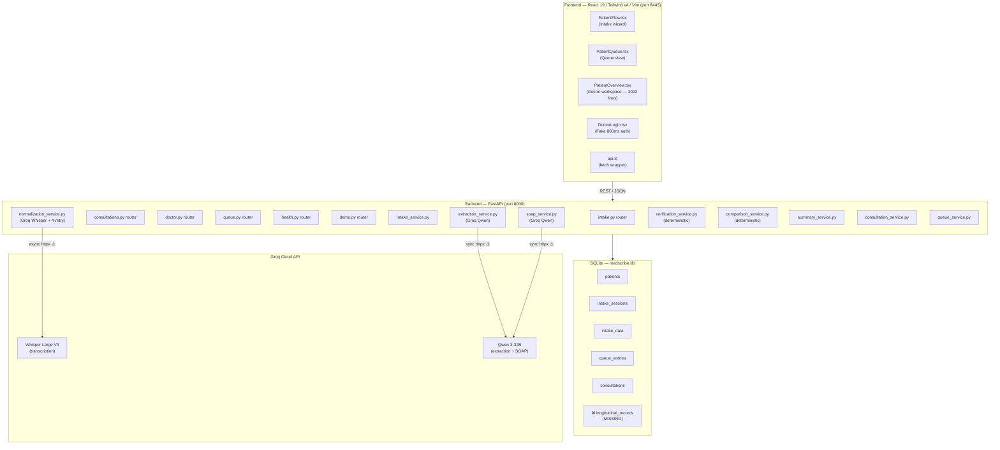
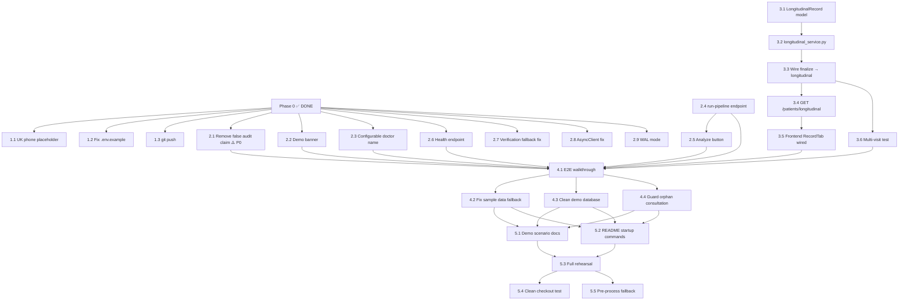

# Medscribe — Implementation Roadmap
**Prepared:** 21 November 2026  
**Prepared by:** Senior Software Architect Investigation (read-only)  
**Target:** Academic / Demo Readiness  
**Source of Truth:** Live repository at `c:\Users\praba\OneDrive\Desktop\Medscribe`

---

> [!IMPORTANT]
> This roadmap is based on verified evidence from the codebase as of 21 November 2026. Every claim cites a specific file and line. Where a reference document (commercial readiness assessment, audit.md) contradicts the actual code, the code is treated as correct and the discrepancy is noted.

---

## Table of Contents

1. [Executive Summary](#1-executive-summary)
2. [Architecture & Technology Stack](#2-architecture--technology-stack)
3. [Feature-by-Feature Completion Matrix](#3-feature-by-feature-completion-matrix)
4. [Bugs, Missing Features & Integration Gaps](#4-bugs-missing-features--integration-gaps)
5. [Clinical Safety Risks](#5-clinical-safety-risks)
6. [Phased Implementation Roadmap](#6-phased-implementation-roadmap)
7. [Dependency Order](#7-dependency-order)
8. [Testing Strategy & Acceptance Criteria](#8-testing-strategy--acceptance-criteria)
9. [Estimated Effort](#9-estimated-effort)
10. [Definition of Done](#10-definition-of-done)

---

## 1. Executive Summary

Medscribe is **approximately 70% complete** toward academic demonstration readiness as of this assessment.

| Dimension | Status |
|---|---|
| Module 1 — Patient Intake | ✅ ~95% complete |
| Module 2 — Consultation Intelligence | ✅ ~90% complete |
| Module 3 — Longitudinal Patient Record | ⚠️ ~30% complete (frontend only, no backend) |
| Automated tests | ✅ 44/44 pass (163.99 s, as of 20 Nov 2026) |
| Phase 0 baseline tasks | ✅ All 5 complete |
| Git history | ✅ 3 commits on `main`, 1 ahead of `origin/main` |
| Demo-blocking bugs | ❌ 4 P0 issues outstanding |

**What works today:** A patient can be registered, complete a multilingual voice or text intake, enter the queue, and be seen by a doctor in a workspace that runs the full Extract → SOAP → Verify → Compare → Finalize pipeline. All pipeline steps are tested and pass.

**What is missing:** Module 3 has no persistent backend. The longitudinal record displayed in the frontend is assembled from React in-memory aggregation of finalized SOAP notes — it has no dedicated database table, no cross-visit reconciliation service, and no provenance-linked API endpoint. This is the single largest remaining gap.

**Other outstanding issues:** Four P0 issues must be fixed before any demo (false audit-log claim in login UI, malformed `.env.example`, undocumented port 8443, unclean demo database). Additionally, the pipeline currently requires four separate manual UI clicks rather than a single action.

**Recommendation:** Implement the roadmap in Phase order. Phases 1–3 bring the application to functional completeness. Phases 4–5 achieve demo polish and rehearsal. Total estimated effort is **34–49 hours** of focused development.

---

## 2. Architecture & Technology Stack

### 2.1 Verified Stack

| Layer | Technology | Version | Notes |
|---|---|---|---|
| Frontend | React | 19 | Figma Make scaffold |
| Frontend styling | Tailwind CSS | v4 | |
| Frontend bundler | Vite | 8 | |
| Frontend package manager | pnpm | — | |
| Frontend dev port | **8443** | — | `vite.config.ts:L34` — not 5173 |
| Backend framework | FastAPI | — | `Backend/main.py` |
| ORM | SQLAlchemy | — | `Backend/db/session.py` |
| Database | SQLite | — | `Backend/medscribe.db` |
| Backend dev port | 8000 | — | Uvicorn default |
| AI transcription | Groq Whisper Large V3 | — | `Backend/services/normalization_service.py` |
| AI extraction & SOAP | Groq Qwen (`qwen3-32b`) | — | `Backend/services/extraction_service.py`, `soap_service.py` |
| HTTP client | `httpx` (sync `Client`) | — | ⚠️ Blocks event loop — see §4 |
| Auth | None | — | `DoctorLogin.tsx:L15` — 800 ms `setTimeout` fake login |
| CORS | Explicit allowlist | — | `localhost:5173`, `localhost:8443` only |

### 2.2 Architecture Diagram



### 2.3 Known Architectural Issues

| Issue | Location | Severity |
|---|---|---|
| Synchronous `httpx.Client` blocks async event loop during all LLM calls | `extraction_service.py`, `soap_service.py`, `normalization_service.py` | P2 |
| SQLite WAL mode not enabled — concurrent reads block during writes | `db/session.py` | P2 |
| No authentication layer — doctor login is a UI pretense only | `DoctorLogin.tsx:L15` | Accepted for demo scope |
| Health endpoint returns static `{"status": "healthy"}` without DB or Groq check | `health.py` | P1 |
| No longitudinal database table or reconciliation service | `db/models.py` | P1 — Module 3 gap |

---

## 3. Feature-by-Feature Completion Matrix

### Module 1 — Patient Intake

| Feature | Status | Evidence |
|---|---|---|
| Multilingual intake: English | ✅ Complete | `patientLocalization.ts:L1-120` |
| Multilingual intake: Hindi | ✅ Complete | `patientLocalization.ts` Hindi strings |
| Multilingual intake: Hinglish | ✅ Complete | `patientLocalization.ts` Hinglish strings |
| Voice input + Groq Whisper transcription | ✅ Complete | `normalization_service.py`; tested in `test_normalization.py` |
| Four-attempt retry on Groq 429 | ✅ Complete | `normalization_service.py` — Phase 0 fix |
| Original patient statement preservation | ✅ Complete | `intake_data.original_text` column |
| Normalization to clinical English | ✅ Complete | `normalization_service.py` |
| Adaptive symptom questionnaire | ✅ Complete | `PatientFlow.tsx` conditional question tree |
| Follow-up questions for each complaint | ✅ Complete | `intake_service.py` |
| Structured medical history (diabetes, HTN, asthma) | ✅ Complete | `IntakeData` schema |
| Multiple complaints and custom symptoms | ✅ Complete | `PatientFlow.tsx` multi-complaint flow |
| Returning patient identification | ✅ Complete | `GET /api/patients/search` |
| Separate intake sessions per visit | ✅ Complete | `intake_sessions` table with `force_new` flag |
| Queue management | ✅ Complete | `queue_service.py`; `queue_entries` table |
| Queue position and estimated wait time | ✅ Complete | `GET /api/queue/position/{id}` |
| Queue status updates | ✅ Complete | `queue_entries.status` field |
| Structured pre-consultation summary | ✅ Complete | `summary_service.py`; `GET /api/doctor/summary/{id}` |
| Dynamic patient age calculation | ✅ Complete | Phase 0 fix — calculated from DOB |
| UK phone placeholder in English locale | ⚠️ Minor bug | `patientLocalization.ts:L107` — shows UK format |

**Module 1 overall: 18/19 features complete. One minor localization bug.**

---

### Module 2 — Consultation Intelligence

| Feature | Status | Evidence |
|---|---|---|
| Consultation record creation | ✅ Complete | `POST /api/consultations/` |
| Transcript entry and persistence | ✅ Complete | `consultations.transcript` column |
| Manual speaker tagging | ✅ Complete | `PatientOverview.tsx` TranscriptTab speaker dropdown |
| Automatic speaker diarization | ❌ Not implemented | Explicitly deferred — mentor decision pending |
| Agent 1: Clinical information extraction | ✅ Complete | `extraction_service.py`; `POST /api/consultations/{id}/extract` |
| Structured extraction with provenance | ✅ Complete | `ClinicalData` schema with source tracking |
| Agent 2: SOAP note generation | ✅ Complete | `soap_service.py`; `POST /api/consultations/{id}/soap` |
| Conservative sentinel values in SOAP | ✅ Complete | "Not documented.", "Not explicitly documented." |
| Agent 3: Claim verification (deterministic) | ✅ Complete | `verification_service.py`; `POST /api/consultations/{id}/verify` |
| Agent 4: Intake-vs-consultation comparison (deterministic) | ✅ Complete | `comparison_service.py`; `POST /api/consultations/{id}/compare` |
| Doctor review of discrepancies | ✅ Complete | `PatientOverview.tsx` DiscrepancyTab |
| Discrepancy resolution | ✅ Complete | `POST /api/consultations/{id}/resolve-discrepancy` |
| Doctor approval and finalization | ✅ Complete | `POST /api/consultations/{id}/finalize` |
| Finalization guard (idempotent, no re-finalization) | ✅ Complete | `consultation_service.py` finalized check |
| Raw transcript preservation | ✅ Complete | `consultations.transcript` immutable after finalization |
| AI draft distinct from approved record | ✅ Complete | `consultations.soap_note` vs `consultations.final_record` |
| Consultation retrieval and visit isolation | ✅ Complete | `GET /api/consultations/patient/{id}` |
| Consultation voice input (audio upload) | ✅ Complete | `POST /api/consultations/{id}/transcribe` |
| Single-click pipeline button | ❌ Missing | No `run-pipeline` endpoint; requires 4 manual UI clicks |
| Hardcoded doctor name "Dr. J. Patel" | ⚠️ Bug | `consultation_service.py:L509`; `PatientOverview.tsx:L231` |
| Verification 3-word false-positive fallback | ⚠️ Bug | `verification_service.py:L162-166` |

**Module 2 overall: 17/20 features complete. 1 missing (single-click pipeline), 2 known bugs.**

---

### Module 3 — Longitudinal Patient Record

| Feature | Status | Evidence |
|---|---|---|
| Previous consultations list (UI) | ✅ Complete | `HistoryTab` in `PatientOverview.tsx:L698-895` |
| Previous visit count on summary | ✅ Complete | `SummaryTab` |
| Multi-visit retrieval endpoint | ✅ Complete | `GET /api/consultations/patient/{id}` |
| Start new visit (force_new) | ✅ Complete | `PatientOverview.tsx` "Start New Visit" button |
| Expandable SOAP cards per visit (UI) | ✅ Complete | `HistoryTab` accordion |
| **Persistent longitudinal database model** | ❌ Missing | No `LongitudinalRecord` model in `db/models.py` |
| **Reconciliation service** | ❌ Missing | No `longitudinal_service.py` |
| **`GET /api/patients/{id}/longitudinal` endpoint** | ❌ Missing | No patients router |
| **Active conditions list** | ❌ Missing | No backend; frontend uses `useMemo()` aggregation |
| **Medication tracking across visits** | ❌ Missing | No cross-visit deduplication |
| **Allergy tracking across visits** | ❌ Missing | No persistent allergy table |
| **Cross-visit deduplication** | ❌ Missing | No reconciliation logic |
| **Fact-level provenance with source visit ID** | ❌ Missing | No source_visit_id FK on any longitudinal record |
| **Status tracking (active / resolved / not_mentioned)** | ❌ Missing | No status lifecycle |
| **Frontend wired to real longitudinal API** | ❌ Missing | `RecordTab` reads from in-memory React aggregation |

**Module 3 overall: 5/15 features complete. 10 backend features entirely missing.**

> [!WARNING]
> The longitudinal record displayed in the frontend today is a **React in-memory illusion**. The `RecordTab` aggregates data from the already-fetched consultation list using `useMemo()`. This data is not persistent, not deduplicated, has no provenance linkage, and is lost on page reload of a fresh session. It must not be presented as "the longitudinal record is implemented."

---

## 4. Bugs, Missing Features & Integration Gaps

### P0 — Demo-Blocking (must fix before any demo)

| ID | Issue | Location | Fix |
|---|---|---|---|
| P0-1 | `DoctorLogin.tsx` displays "All activity is audit-logged and encrypted" — this is false; no audit logging exists | `DoctorLogin.tsx:L42` | Remove or replace with "Demo Mode — not for clinical use" |
| P0-2 | `.env.example` has malformed `GROQ_API_KEY` with trailing `./` — will silently break Groq calls for new developers | `.env.example:L1` | Fix value format |
| P0-3 | Frontend runs on **port 8443** (not 5173) — not documented anywhere in README or setup guides | `vite.config.ts:L34` | Add startup note to README |
| P0-4 | `medscribe.db` contains 29 real test patients and 28 consultations — demo will show polluted data | Live database | Delete `medscribe.db` and re-seed with `POST /demo/seed` before demo |

### P1 — High Priority (fix before demo, not immediately blocking)

| ID | Issue | Location | Fix |
|---|---|---|---|
| P1-1 | Doctor name "Dr. J. Patel" hardcoded in both backend and frontend | `consultation_service.py:L509`; `PatientOverview.tsx:L231` | Make configurable; read from doctor identity state |
| P1-2 | Health endpoint returns static `{"status": "healthy"}` without checking DB connectivity or Groq reachability | `health.py` | Add real DB ping and Groq status check |
| P1-3 | No single-click pipeline — doctor must click Extract, then SOAP, then switch tabs to Verification, then click Run All — 4 steps | `PatientOverview.tsx` | Add `POST /api/consultations/{id}/run-pipeline` and "⚡ Analyze" button |
| P1-4 | Module 3 has no backend — 10 features entirely missing | `db/models.py` | Implement Phase 3 (see §6) |
| P1-5 | Phase 0 commits not pushed to remote — `origin/main` is 1 commit behind | Git | `git push origin main` |

### P2 — Medium Priority (fix before demo if time allows)

| ID | Issue | Location | Fix |
|---|---|---|---|
| P2-1 | Synchronous `httpx.Client` used in async FastAPI handlers — Groq API calls block the entire event loop | `extraction_service.py`, `soap_service.py`, `normalization_service.py` | Switch to `httpx.AsyncClient` with `await` |
| P2-2 | SQLite WAL mode not enabled — concurrent reads contend with writes | `db/session.py` | Execute `PRAGMA journal_mode=WAL` on connection |
| P2-3 | Verification 3-word fallback at `verification_service.py:L162-166` can mark unsupported claims as SUPPORTED if any 3 consecutive words appear in the transcript, regardless of context | `verification_service.py:L162-166` | Raise minimum match threshold or require full phrase |
| P2-4 | Sample data fallback in `PatientOverview.tsx` can silently mask real API errors, making the app appear to work when it isn't | `PatientOverview.tsx` | Log errors visibly; replace fallback with error state |
| P2-5 | English locale phone placeholder shows UK format (+44) | `patientLocalization.ts:L107` | Change to `+91 XXXXX XXXXX` or appropriate locale |

### Integration Gaps

| Gap | Description | Impact |
|---|---|---|
| Longitudinal record not wired to finalization | `finalize_consultation()` does not call any longitudinal update | Module 3 will never populate even after backend is built, unless wired |
| `patients.py` router does not exist | No `/api/patients/{id}/longitudinal` endpoint possible without creating this router | Module 3 endpoint cannot exist until router is registered |
| `run-pipeline` endpoint does not exist | Frontend cannot trigger full pipeline in one call | Demo requires 4 separate manual clicks |
| Consultation auto-creation on doctor workspace load may create orphaned consultations | If doctor opens workspace for a patient who already has an in-progress consultation, a second may be created | Needs investigation and guard |

---

## 5. Clinical Safety Risks

> [!CAUTION]
> These risks affect the correctness and trustworthiness of the system during a demonstration. They must be addressed or explicitly disclosed before presenting to any clinical or academic audience.

### RISK-1: False Audit Log Claim (P0)
**Description:** `DoctorLogin.tsx:L42` states "All activity is audit-logged and encrypted." No audit logging of any kind exists in the backend. No encryption at rest is implemented.  
**Impact:** If a clinician or examiner reads this during a demo, it is a false claim about a safety-critical feature.  
**Mitigation:** Remove the claim. Replace with an explicit "Demo Mode — Not for clinical use" notice.

### RISK-2: Verification False Positive (P2)
**Description:** `verification_service.py:L162-166` uses a 3-word sliding window fallback. Any claim whose 3 consecutive words appear anywhere in the transcript is marked SUPPORTED, regardless of clinical context.  
**Example:** A claim that "Patient has no fever" could be marked SUPPORTED if the transcript contains the phrase "has no" anywhere, even in a different context.  
**Impact:** Verification results presented to a doctor may incorrectly show SUPPORTED for unverified claims.  
**Mitigation:** Raise the minimum word match threshold. Prefer exact phrase matching.

### RISK-3: Longitudinal Record is an Illusion (P1)
**Description:** The "Patient Record" tab shows what appears to be a persistent longitudinal medical record. It is in fact a `useMemo()` aggregation of the already-loaded consultation list — assembled in the browser, not stored in a database.  
**Impact:** A doctor using this view would believe they are seeing a persistent, reconciled medical history. They are seeing a temporary browser-computed view.  
**Mitigation:** Implement the Module 3 backend (Phase 3 of this roadmap). Clearly label the current view as "computed from finalized visits" until real longitudinal storage is implemented.

### RISK-4: No Circuit Breaker for Groq Failures (P2)
**Description:** If Groq Cloud is unavailable, all LLM-dependent steps (transcription, extraction, SOAP) will fail with unhandled timeout errors. The synchronous `httpx.Client` will block the event loop during the timeout.  
**Impact:** A Groq outage during a demo will freeze the backend server.  
**Mitigation:** Switch to `httpx.AsyncClient`; add timeout configuration; return structured error responses to the frontend.

### RISK-5: Unclean Demo Database (P0)
**Description:** `medscribe.db` currently contains 29 test patients, 47 intake sessions, 33 intake entries, 33 queue entries, and 28 consultations — all test data. These will appear in the demo.  
**Impact:** Demo audience sees polluted, inconsistent test data.  
**Mitigation:** Delete `medscribe.db` and seed with synthetic demo data using `POST /demo/seed` before the demo.

### Confirmed Safe Invariants

The following clinical safety invariants were verified in the codebase and all hold correctly:

| Invariant | Status | Evidence |
|---|---|---|
| AI-generated draft (soap_note) is distinct from doctor-approved record (final_record) | ✅ | `consultations` table, two separate columns |
| Finalization is idempotent and guarded — no re-finalization of approved consultations | ✅ | `consultation_service.py` finalized guard |
| Raw transcript is preserved and not overwritten after finalization | ✅ | `consultations.transcript` immutable |
| Sentinel values present for undocumented clinical items | ✅ | "Not documented.", "Not explicitly documented." |
| Cross-patient data isolation enforced at query level | ✅ | All queries filter by `patient_id` or `consultation_id` |
| Provenance chain from intake through extraction to SOAP maintained | ✅ | `ClinicalData` schema with source fields |
| "Not mentioned" ≠ "resolved" — comparison agent flags absence, does not auto-close | ✅ | `comparison_service.py` |

---

## 6. Phased Implementation Roadmap

> [!NOTE]
> Phase 0 is complete. All subsequent phases are ordered by dependency. Do not skip phases or reorder tasks within a phase unless the dependency order in §7 permits it.

---

### Phase 0 — Baseline & Stabilization ✅ COMPLETE

**Completed tasks (verified in code):**

| Task | Evidence |
|---|---|
| Git repository initialized and connected to GitHub | 3 commits on `main` |
| Four-attempt retry for Groq 429 errors in normalization | `normalization_service.py` |
| Dynamic patient age calculation from DOB | Verified in intake service |
| CORS restricted from `["*"]` to explicit origin list | `main.py` |
| All 44 automated tests passing | 44/44, 163.99 s |

> [!NOTE]
> The commercial readiness assessment document states CORS was `["*"]` and normalization had no retry. Both claims are **outdated** — Phase 0 fixed both. The assessment document should not be treated as current state.

---

### Phase 1 — Module 1 Cleanup

**Goal:** Close the remaining minor gaps in Module 1 and synchronize the remote repository.

**Estimated total effort: 1 hour**

#### Task 1.1 — Fix UK Phone Placeholder
- **File:** `Frontend/src/localization/patientLocalization.ts:L107`
- **Change:** Replace `+44 XXXX XXXXXX` with `+91 XXXXX XXXXX` (or configurable locale)
- **Effort:** 2 minutes
- **Test:** Visual inspection during intake form

#### Task 1.2 — Fix `.env.example` Malformed Key
- **File:** `.env.example:L1`
- **Change:** Remove trailing `./` from `GROQ_API_KEY` example value
- **Effort:** 1 minute
- **Test:** Confirm new developers can follow setup instructions without error

#### Task 1.3 — Push Phase 0 Commits to Remote
- **Command:** `git push origin main`
- **Effort:** 1 minute
- **Test:** Confirm `git status` shows "Your branch is up to date with 'origin/main'"

---

### Phase 2 — Module 2 Completion

**Goal:** Fix all P0 and P1 bugs in the consultation pipeline and add the single-click pipeline endpoint.

**Estimated total effort: 10–15 hours**

#### Task 2.1 — Remove False Audit Log Claim *(P0)*
- **File:** `Frontend/src/components/DoctorLogin.tsx:L42`
- **Change:** Remove "All activity is audit-logged and encrypted." Replace with: "Demo Mode — Not for clinical use."
- **Effort:** 5 minutes
- **Acceptance:** Doctor login screen contains no false security claims

#### Task 2.2 — Add Demo Mode Banner to Doctor Login
- **File:** `DoctorLogin.tsx`
- **Change:** Add a visible amber/yellow banner: "⚠️ Demonstration system — not for clinical use. No authentication or data encryption is active."
- **Effort:** 15 minutes
- **Acceptance:** Banner is visible and cannot be missed by demo audience

#### Task 2.3 — Make Doctor Name Configurable *(P1)*
- **Files:** `consultation_service.py:L509`; `PatientOverview.tsx:L231`
- **Change:**
  1. Backend: change default doctor name in `consultation_service.py` to read from an environment variable `DOCTOR_NAME` (default: `"Dr. [Name]"`)
  2. Frontend: allow doctor name to be set at login (input field in `DoctorLogin.tsx`) and passed as a parameter in the `finalize` API call
- **Effort:** 30 minutes
- **Acceptance:** Finalizing a consultation with a custom doctor name persists that name in `final_record`

#### Task 2.4 — Add `POST /api/consultations/{id}/run-pipeline` Endpoint *(P1)*
- **File:** `Backend/routes/consultations.py`; `Backend/services/consultation_service.py`
- **Change:** Add a new endpoint that sequentially calls:
  1. `extract_clinical_data()`
  2. `generate_soap()`
  3. `verify_soap()`
  4. `compare_intake_consultation()`
  
  Returns the combined result of all four steps as a single response object. Each step's result should be persisted before the next step begins. If any step fails, return a partial result with an `error` field indicating which step failed and why.
- **Effort:** 2–3 hours
- **Acceptance:** A single POST call to `run-pipeline` produces a fully processed consultation with extraction, SOAP, verification, and comparison results persisted in the database

#### Task 2.5 — Add "⚡ Analyze Consultation" Button in TranscriptTab *(P1)*
- **File:** `Frontend/src/components/PatientOverview.tsx`
- **Change:**
  1. Add an "⚡ Analyze Consultation" button in `TranscriptTab` (visible after transcript is non-empty)
  2. Button calls `POST /api/consultations/{id}/run-pipeline`
  3. On success: navigate to the SOAPTab and show a success toast
  4. On failure: show error toast with which step failed
  5. Show loading spinner during analysis (expected 15–30 s for real Groq calls)
- **Effort:** 1–2 hours
- **Acceptance:** A doctor can enter a transcript and click one button to get extraction, SOAP, verification, and comparison results without manual tab switching

#### Task 2.6 — Improve Health Endpoint *(P1)*
- **File:** `Backend/routes/health.py`
- **Change:** Replace static `{"status": "healthy"}` with:
  1. A real database ping (execute `SELECT 1`)
  2. A check that `GROQ_API_KEY` environment variable is set (do not make a live API call — just check the key exists and has non-trivial length)
  3. Return: `{"status": "healthy"|"degraded"|"unhealthy", "db": "ok"|"error", "groq_key_configured": true|false}`
- **Effort:** 30 minutes
- **Acceptance:** `GET /health` returns a meaningful status that reflects actual system readiness

#### Task 2.7 — Fix Verification 3-Word Fallback *(P2)*
- **File:** `Backend/services/verification_service.py:L162-166`
- **Change:**
  1. Raise minimum sliding-window match from 3 words to 6 words
  2. Add a minimum confidence threshold — only mark SUPPORTED if word overlap exceeds 60% of the claim's total word count
  3. Add a test case: a claim whose 3 words appear in unrelated transcript context must NOT be marked SUPPORTED
- **Effort:** 2 hours
- **Acceptance:** Verification 3-word false-positive rate is eliminated for clearly out-of-context matches; existing 44 tests continue to pass

#### Task 2.8 — Fix Synchronous `httpx` Blocking Event Loop *(P2)*
- **Files:** `Backend/services/extraction_service.py`, `soap_service.py`, `normalization_service.py`
- **Change:**
  1. Replace `httpx.Client` with `httpx.AsyncClient`
  2. Replace synchronous `client.post()` calls with `await client.post()`
  3. Add a 60-second timeout to all Groq API calls
  4. Ensure all calling route handlers are `async def` (they already are in FastAPI — verify each)
- **Effort:** 2–3 hours
- **Acceptance:** Backend can handle concurrent requests without event loop blocking; Groq timeouts return a structured error rather than hanging

#### Task 2.9 — Enable SQLite WAL Mode *(P2)*
- **File:** `Backend/db/session.py`
- **Change:** Execute `PRAGMA journal_mode=WAL` as a connection event listener on SQLAlchemy engine creation
- **Effort:** 5 minutes
- **Acceptance:** Concurrent reads do not block during write operations (observable via multiple simultaneous queue requests)

---

### Phase 3 — Module 3 Backend Implementation

**Goal:** Build the persistent longitudinal patient record backend. This is the largest remaining gap and requires 6 sequential tasks.

**Estimated total effort: 15–20 hours**

> [!IMPORTANT]
> These tasks must be executed in order. Task 3.1 creates the database model that all other tasks depend on. Task 3.2 creates the service that Task 3.3 wires. The frontend (Task 3.5) cannot display real data until 3.1–3.4 are complete.

#### Task 3.1 — Create `LongitudinalRecord` SQLAlchemy Model
- **File:** `Backend/db/models.py`
- **Change:** Add the following model:

```python
class LongitudinalRecord(Base):
    __tablename__ = "longitudinal_records"
    
    id = Column(Integer, primary_key=True, index=True)
    patient_id = Column(Integer, ForeignKey("patients.id"), nullable=False, index=True)
    category = Column(String, nullable=False)  # 'symptom' | 'condition' | 'medication' | 'allergy' | 'diagnosis'
    value = Column(String, nullable=False)      # Normalized clinical text
    status = Column(String, default="active")  # 'active' | 'resolved' | 'not_mentioned'
    provenance = Column(String, default="ai_extracted")  # 'patient_reported' | 'ai_extracted' | 'doctor_confirmed'
    source_visit_id = Column(Integer, ForeignKey("consultations.id"), nullable=True)
    first_documented_at = Column(DateTime, default=datetime.utcnow)
    last_updated_at = Column(DateTime, default=datetime.utcnow, onupdate=datetime.utcnow)
    last_updated_visit_id = Column(Integer, ForeignKey("consultations.id"), nullable=True)
```

- Also add `ensure_schema_migrations()` or `Base.metadata.create_all()` call in `main.py` startup to create the new table without breaking existing tables.
- **Effort:** 1 hour
- **Acceptance:** `longitudinal_records` table is created on backend startup; existing tables are unaffected; existing 44 tests still pass

#### Task 3.2 — Create `longitudinal_service.py`
- **File:** `Backend/services/longitudinal_service.py` (new file)
- **Purpose:** On consultation finalization, extract confirmed clinical facts and upsert them into `longitudinal_records`

**Key function:** `update_longitudinal_on_finalize(patient_id, consultation_id, final_record, clinical_data, db)`

**Logic:**

```
For each allergy in clinical_data.allergies:
    upsert LongitudinalRecord(category='allergy', value=allergy.name, status='active',
                              provenance='patient_reported', source_visit_id=consultation_id)

For each confirmed medication in final_record.plan:
    upsert LongitudinalRecord(category='medication', value=medication.name, status='active',
                              provenance='doctor_confirmed', source_visit_id=consultation_id)

For each confirmed diagnosis in final_record.assessment:
    upsert LongitudinalRecord(category='diagnosis', value=diagnosis.name, status='active',
                              provenance='doctor_confirmed', source_visit_id=consultation_id)

For each condition in clinical_data.medical_history:
    upsert LongitudinalRecord(category='condition', value=condition.name, status='active',
                              provenance='patient_reported', source_visit_id=consultation_id)
```

**Upsert rule:** If a `LongitudinalRecord` with the same `patient_id`, `category`, and normalized `value` already exists, update `last_updated_at`, `last_updated_visit_id`, and `status` to `'active'`. Do not create duplicates.

**Important constraints:**
- Never automatically set `status='resolved'` — only a doctor action can resolve a fact
- `status='not_mentioned'` may be set for existing active facts that were not referenced in the new consultation's comparison output (use the comparison agent's output to identify items in the previous intake that were absent from the consultation)
- Preserve the original `source_visit_id` (first visit where this fact was documented)

- **Effort:** 4–6 hours
- **Acceptance:** After finalizing a consultation with a known allergy, `longitudinal_records` contains a row for that allergy with correct `patient_id`, `source_visit_id`, `category='allergy'`, and `status='active'`

#### Task 3.3 — Wire `update_longitudinal_on_finalize` into `finalize_consultation()`
- **File:** `Backend/services/consultation_service.py`
- **Change:**
  1. Import `longitudinal_service`
  2. At the end of `finalize_consultation()`, after persisting `final_record`, call `longitudinal_service.update_longitudinal_on_finalize(patient_id, consultation_id, final_record, clinical_data, db)`
  3. Wrap in try/except — longitudinal update failure must NOT roll back or block consultation finalization (log the error; do not raise)
- **Effort:** 30 minutes
- **Acceptance:** Calling `POST /api/consultations/{id}/finalize` populates `longitudinal_records`; a finalization failure in longitudinal update does not break the finalization itself

#### Task 3.4 — Add `GET /api/patients/{id}/longitudinal` Endpoint
- **File:** `Backend/routes/patients.py` (new file)
- **Change:**
  1. Create a new FastAPI router with prefix `/api/patients`
  2. Add `GET /{patient_id}/longitudinal` endpoint
  3. Query `longitudinal_records` for the given `patient_id`, ordered by `category`, then `last_updated_at` DESC
  4. Return:
  ```json
  {
    "patient_id": 1,
    "generated_at": "2026-11-21T...",
    "records": [
      {
        "id": 1,
        "category": "allergy",
        "value": "Penicillin",
        "status": "active",
        "provenance": "patient_reported",
        "source_visit_id": 5,
        "first_documented_at": "...",
        "last_updated_at": "...",
        "last_updated_visit_id": 7
      }
    ]
  }
  ```
  5. Register the new router in `Backend/main.py`
- **Effort:** 1–2 hours
- **Acceptance:** `GET /api/patients/{id}/longitudinal` returns a valid JSON response with the patient's longitudinal record; returns `[]` for patients with no finalized consultations

#### Task 3.5 — Wire Frontend RecordTab to Real Longitudinal API
- **File:** `Frontend/src/components/PatientOverview.tsx`
- **Change:**
  1. Add `useEffect` to call `GET /api/patients/{id}/longitudinal` when `RecordTab` is active
  2. Replace the `useMemo()` aggregation currently used in `RecordTab` with the real API response
  3. Display: category groups (Allergies, Medications, Diagnoses, Conditions), status badges (active / resolved / not_mentioned), source visit linkable text ("First documented: Visit #5")
  4. Add loading and error states — do not silently fall back to fake data
  5. Keep the `HistoryTab` accordion (expandable SOAP cards) as-is — it still serves a valid purpose for browsing visit history
- **Effort:** 3–4 hours
- **Acceptance:** `RecordTab` shows real data from the database that persists across page reloads; data updates after each finalization

#### Task 3.6 — Write Multi-Visit Longitudinal Integration Test
- **File:** `Backend/tests/test_longitudinal.py` (new file)
- **Test scenarios:**

**Scenario A — First visit establishes longitudinal facts:**
1. Create patient + intake session with Penicillin allergy and Fever
2. Create consultation, run extraction + SOAP + verify + compare
3. Finalize consultation
4. Assert `longitudinal_records` contains: `{category: 'allergy', value: 'Penicillin', status: 'active', source_visit_id: <visit_1>}`
5. Assert `longitudinal_records` contains a symptom/condition for Fever

**Scenario B — Second visit updates longitudinal record:**
1. Using same patient from Scenario A
2. Create new intake session (`force_new=True`) with Penicillin allergy mentioned + new complaint Headache (no Fever)
3. Create second consultation, finalize
4. Assert Penicillin allergy still `status='active'`
5. Assert Fever record has `status='not_mentioned'`
6. Assert Headache record has `status='active'`
7. Assert Penicillin `source_visit_id` = visit_1 (unchanged — first documented remains)

**Scenario C — Longitudinal endpoint returns all records:**
1. After both visits above: `GET /api/patients/{id}/longitudinal`
2. Assert response contains all 3 facts (Penicillin, Fever, Headache) with correct statuses

- **Effort:** 2–3 hours
- **Acceptance:** All 3 scenarios pass; total test count increases to 47+ tests with 0 failures

---

### Phase 4 — End-to-End Integration

**Goal:** Verify the complete user journey without broken data flow. Fix remaining integration gaps.

**Estimated total effort: 5–8 hours**

#### Task 4.1 — Full E2E Integration Test (Manual Walkthrough)
- Trace the complete journey: Patient registration → Intake → Queue → Doctor workspace → Pre-consultation summary → Transcript entry → "⚡ Analyze" → SOAP review → Discrepancy resolution → Finalize → RecordTab shows longitudinal record
- Use a synthetic demo patient (not real patient data)
- Document any step that breaks, displays wrong data, or requires confusing manual action
- **Effort:** 2 hours
- **Acceptance:** Complete journey works without developer intervention

#### Task 4.2 — Fix Sample Data Fallback Masking API Errors
- **File:** `Frontend/src/components/PatientOverview.tsx`
- **Change:** Where the frontend silently falls back to sample data on API error, replace with a visible error state: "Failed to load patient data — check backend connection." Log the original error to browser console.
- **Effort:** 1–2 hours
- **Acceptance:** A broken backend API call shows an error state, not fake sample data

#### Task 4.3 — Prepare Clean Demo Database
- Delete `Backend/medscribe.db`
- Start backend (`uvicorn main:app --reload`)
- Confirm auto-creation of all 6 tables (including `longitudinal_records`)
- Seed synthetic demo data: `POST /demo/seed`
- Verify seed creates 2–3 synthetic patients with plausible names, DOBs, and medical histories
- **Effort:** 30 minutes
- **Acceptance:** Fresh database with clean synthetic data is ready for demo

#### Task 4.4 — Guard Against Orphaned Consultation Creation
- **File:** `Backend/services/consultation_service.py`; `Backend/routes/consultations.py`
- **Investigate:** Determine whether the `POST /api/consultations/` endpoint creates a new consultation if one already exists for the patient in the current visit. If so, add a guard: return the existing in-progress consultation rather than creating a duplicate.
- **Effort:** 1–2 hours
- **Acceptance:** Opening the doctor workspace for a patient with an in-progress consultation does not create a second consultation record

---

### Phase 5 — Demo Readiness

**Goal:** Rehearse, time, and document the complete demo scenario.

**Estimated total effort: 3–5 hours**

#### Task 5.1 — Prepare Demo Scenario Documentation
- Write a `DEMO_GUIDE.md` in the repository root
- Document: 2–3 demo patients (synthetic names, ages, complaint scenarios)
- Scenario A: New patient with multilingual intake (Hindi/Hinglish)
- Scenario B: Returning patient — second visit showing longitudinal record update
- Scenario C: Consultation with discrepancy (intake mentions allergy not discussed in consultation)
- **Effort:** 1 hour

#### Task 5.2 — Document Exact Startup Commands in README
- Update `README.md` to include:
  1. Backend: `cd Backend && uvicorn main:app --reload` (port 8000)
  2. Frontend: `cd Frontend && pnpm dev` (port **8443**, not 5173)
  3. `.env` setup: copy `.env.example`, add real `GROQ_API_KEY`
  4. Demo seed: `curl -X POST http://localhost:8000/demo/seed`
  5. Test run: `cd Backend && pytest tests/ -v`
- **Effort:** 30 minutes

#### Task 5.3 — Full End-to-End Rehearsal with Timing
- Run the complete demo scenario from Task 5.1 with a timer
- Record: time for each pipeline step (extraction ~8–15 s, SOAP ~8–15 s), total demo time
- Identify any step that takes unexpectedly long and add a loading indicator if missing
- **Effort:** 1–2 hours

#### Task 5.4 — Confirm All Tests Pass on Clean Checkout
- Delete virtual environment and `medscribe.db`
- Fresh clone / fresh environment
- Run `pytest tests/ -v`
- Confirm all tests pass (target: 47+ tests, 0 failures)
- **Effort:** 30 minutes

#### Task 5.5 — Pre-Process Demo Consultation as Fallback (Optional)
- For the primary demo consultation, run Extract → SOAP → Verify → Compare in advance
- Save the consultation state so the demo can show results even if Groq is slow
- This is a risk mitigation step — Groq can be slow or unavailable
- **Effort:** 30 minutes

---

## 7. Dependency Order



**Critical path (longest dependency chain):**  
`3.1 → 3.2 → 3.3 → 3.4 → 3.5 → 4.1 → 4.3 → 5.3 → 5.4`

Tasks that can be done in parallel with the Module 3 chain:
- All Phase 2 tasks (2.1 through 2.9) are independent of Phase 3
- 1.1, 1.2, 1.3 can be done at any time

---

## 8. Testing Strategy & Acceptance Criteria

### 8.1 Existing Test Coverage (Verified)

| File | Tests | Focus |
|---|---|---|
| `test_intake.py` | 4 | Patient registration, intake session, search |
| `test_normalization.py` | 11 | Normalization, multilingual, retry, voice |
| `test_queue.py` | 1 | Queue entry and position |
| `test_extraction.py` | 9 | Clinical extraction with real Groq |
| `test_soap.py` | 9 | SOAP generation, sentinel values |
| `test_verification.py` | 4 | Claim verification, deterministic |
| `test_comparison.py` | 3 | Intake-vs-consultation comparison |
| `test_consultation.py` | 3 | Finalization guard, isolation |
| **Total** | **44** | **All pass as of 20 Nov 2026** |

> [!NOTE]
> Many tests make **real Groq API calls**. A valid `GROQ_API_KEY` in `.env` is required to run the full suite. Tests run against an in-memory SQLite database (StaticPool) with a `clean_tables` autouse fixture.

### 8.2 New Tests Required

| File | Tests | Phase | Priority |
|---|---|---|---|
| `test_longitudinal.py` | 6–8 | Phase 3 | P1 |
| `test_run_pipeline.py` | 3–4 | Phase 2 | P1 |
| `test_doctor_identity.py` | 2 | Phase 2 | P1 |
| `test_health_real.py` | 2 | Phase 2 | P2 |

**Target after all phases: 55+ tests, 0 failures**

### 8.3 Per-Task Acceptance Criteria

| Task | Acceptance Criterion |
|---|---|
| 2.1 | `DoctorLogin.tsx` contains no false security claims |
| 2.3 | `POST /finalize` with `doctor_name="Dr. Test"` → `final_record.doctor` = "Dr. Test" |
| 2.4 | Single call to `POST /run-pipeline` persists extraction + SOAP + verification + comparison |
| 2.5 | Clicking "⚡ Analyze" navigates to SOAPTab with populated SOAP after one click |
| 2.6 | `GET /health` returns `{"db": "ok", "groq_key_configured": true}` with functioning system |
| 2.7 | A claim whose 3 words appear in unrelated transcript context is NOT marked SUPPORTED |
| 3.1 | `longitudinal_records` table created on startup; existing tables unaffected |
| 3.2 | Finalizing consultation with Penicillin allergy → `longitudinal_records` row: `category='allergy', value='Penicillin', status='active'` |
| 3.3 | Longitudinal update failure does not block or roll back finalization |
| 3.4 | `GET /api/patients/{id}/longitudinal` returns JSON with `records` array |
| 3.5 | RecordTab data persists after page reload; shows source visit reference |
| 3.6 | Multi-visit scenario: allergy persists across visits; not_mentioned items flagged; source_visit_id unchanged |
| 4.1 | Full demo journey completes without developer intervention |
| 4.3 | Fresh database has only synthetic seed data; no test artifacts |
| 5.4 | All tests pass on clean checkout without prior environment state |

---

## 9. Estimated Effort

| Phase | Tasks | Effort Range |
|---|---|---|
| Phase 0 — Baseline | 5 (complete) | 0 hours remaining |
| Phase 1 — Module 1 cleanup | 3 trivial | ~1 hour |
| Phase 2 — Module 2 completion | 9 tasks | 10–15 hours |
| Phase 3 — Module 3 backend | 6 tasks | 15–20 hours |
| Phase 4 — Integration | 4 tasks | 5–8 hours |
| Phase 5 — Demo prep | 5 tasks | 3–5 hours |
| **Total** | **27 tasks** | **~34–49 hours** |

**Minimum viable demo path (critical path only):**

| Task | Effort |
|---|---|
| 2.1 Remove false audit claim | 5 min |
| 2.3 Configurable doctor name | 30 min |
| 2.4 run-pipeline endpoint | 2–3 hrs |
| 2.5 Analyze button | 1–2 hrs |
| 3.1 LongitudinalRecord model | 1 hr |
| 3.2 longitudinal_service.py | 4–6 hrs |
| 3.3 Wire finalize | 30 min |
| 3.4 Longitudinal endpoint | 1–2 hrs |
| 3.5 Frontend RecordTab wired | 3–4 hrs |
| 4.3 Clean demo database | 30 min |
| 5.2 README startup docs | 30 min |
| 5.3 Rehearsal | 1–2 hrs |
| **MVP total** | **~15–22 hours** |

---

## 10. Definition of Done

The Medscribe system is **demo-ready** when all of the following conditions are met:

### Functionality
- [ ] **Module 1:** Complete multilingual patient intake (English + Hindi + Hinglish) with voice input works end-to-end, including adaptive questionnaire and queue management
- [ ] **Module 2:** Doctor workspace supports the full pipeline in a single click: Transcript → ⚡ Analyze → SOAP review → Discrepancy resolution → Finalize
- [ ] **Module 3:** `RecordTab` shows a persistent, database-backed longitudinal record that updates after each finalization and persists across page reloads
- [ ] **Module 3:** A second visit for the same patient correctly updates longitudinal status (not_mentioned / active) without duplicating records

### Data Quality
- [ ] Demo database contains only clean synthetic data (no test artifacts from development)
- [ ] All synthetic demo patients have plausible names, ages, medical histories
- [ ] No real patient or developer data in the demo database

### UI Accuracy
- [ ] DoctorLogin screen contains no false security claims
- [ ] DoctorLogin shows a visible "Demo Mode" notice
- [ ] Doctor name is not hardcoded "Dr. J. Patel" — it reflects the name entered at login
- [ ] No UI element shows sample/placeholder data where real data should appear

### Technical Correctness
- [ ] `GET /health` returns actual DB and Groq key status
- [ ] All 44 existing automated tests continue to pass
- [ ] New longitudinal tests pass (target: 47+ tests, 0 failures)
- [ ] Frontend dev port 8443 is documented in README
- [ ] `.env.example` has correct `GROQ_API_KEY` format
- [ ] Phase 0 commits are pushed to `origin/main`

### Clinical Safety
- [ ] All 7 verified clinical safety invariants continue to hold
- [ ] AI draft (`soap_note`) remains distinct from approved record (`final_record`)
- [ ] Finalization guard prevents re-finalization of approved consultations
- [ ] Raw transcripts are preserved and not overwritten
- [ ] Sentinel values ("Not documented.") remain in SOAP for undocumented items
- [ ] Longitudinal update failure does not block or corrupt consultation finalization

### Demo Rehearsal
- [ ] Complete demo journey rehearsed at least once with timing recorded
- [ ] Startup commands confirmed: backend (`uvicorn main:app --reload`, port 8000) + frontend (`pnpm dev`, port 8443)
- [ ] All steps complete within acceptable demo time (< 10 min total for a focused walkthrough)

---

## Open Questions Requiring Human Input

> [!IMPORTANT]
> The following decisions require input from the project owner or mentor before implementation begins. Do not implement Module 3 reconciliation logic without resolving Question 2.

**Q1 — Speaker Diarization (Module 2)**  
The `audit.md` notes that automatic speaker diarization is a pending mentor consultation. Manual speaker tagging is currently implemented. Should automatic diarization (Groq or pyannote.audio) be implemented before the academic demo, or should manual tagging remain the final approach?  
*Impact: If diarization is required, estimate an additional 10–15 hours and a new external dependency.*

**Q2 — Longitudinal Reconciliation Trigger (Module 3)**  
When finalization occurs, should the system:  
(a) **Automatically** populate the longitudinal record with doctor-confirmed facts from the SOAP and clinical extraction — no additional doctor action required?  
(b) Present the doctor with a "Confirm for longitudinal record" step — only facts explicitly confirmed here are added?  
*The roadmap currently assumes option (a) for simplicity. Option (b) is safer but requires additional UI.*

**Q3 — Longitudinal "Resolved" Status (Module 3)**  
What is the clinical rule for marking a longitudinal fact as "resolved"?  
(a) Only when a doctor explicitly clicks "Mark as resolved" in the longitudinal record?  
(b) When the comparison agent detects a discrepancy and the doctor resolves it in the DiscrepancyTab?  
(c) Automatic — resolved when a diagnosis is not mentioned in 2+ consecutive visits?  
*The roadmap currently uses only "active" and "not_mentioned" (never auto-resolves). The "resolved" status requires a defined trigger.*

---

*This roadmap reflects the verified state of the codebase as of 21 November 2026. All findings are evidence-based and cite specific files and line numbers. No files were modified during this investigation.*
